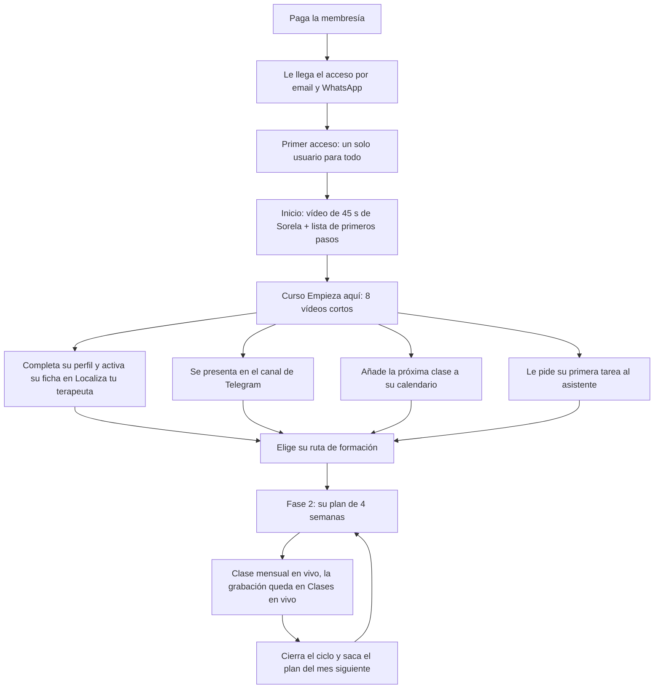

# De Imperio Agéntico a la plataforma Divine

**Cómo funciona por dentro Imperio Agéntico (Skool) y cómo llevar su inicio a la Comunidad Divine, con los vídeos de presentación de Sorela.**

Recorrido hecho el 16 de noviembre de 2026 desde una cuenta de miembro, entrando en todas las pestañas, en las 9 lecciones de "Empieza Aquí", en las 10 de "OS Agéntico · Tu Roadmap" y en el OS Agéntico (su plataforma propia).

---

## 0. Lo esencial

1. **El inicio es un curso corto, siempre el primero del catálogo**: "Empieza Aquí", 9 lecciones. Cada una es un vídeo de 1–2 minutos que explica **una sola zona** de la plataforma.
2. **Cada lección termina con UNA acción concreta**: comentar "Visto", descargar la app, presentarse, apuntarse a una sesión. Así la persona usa la plataforma desde el minuto uno. Y funciona: el post donde se comenta "Visto" tiene **5.200 comentarios**, y el de "Descargada", **3.100**.
3. En la portada hay una **lista de primeros pasos** (3 tareas con check) que lleva al curso de inicio.
4. Después viene un **segundo curso** que te lleva a su herramienta propia, el OS Agéntico, donde la IA te arma un **plan personalizado de 4 semanas** con tareas, minutos, puntos y un "reto" semanal.
5. Hay **niveles con premios reales** (desbloquean cursos, cuentas gratis, sesiones privadas) para que la gente participe.
6. **Para Divine:** copiar la estructura (curso de inicio + una acción por lección + lista de primeros pasos + plan de 4 semanas). **No** copiar el tono militar ni el volumen (34 cursos, 6 directos a la semana).

---

## 1. Mapa de la plataforma

| Pestaña | Qué hay | Para qué le sirve al miembro |
|---|---|---|
| **Comunidad** | El feed: publicaciones de los miembros por categorías, posts fijados, lista de primeros pasos, aviso del próximo directo | Preguntar, presentarse, enseñar logros, enterarse de todo |
| **Cursos** | 34 cursos en tarjetas con portada, una frase y barra de % | Aprender. Algunos cursos se desbloquean por nivel o pagando el plan anual |
| **Calendario** | Vista mensual con los directos de cada semana | Saber cuándo hay sesión, entrar al Zoom y añadirla a su calendario |
| **Miembros** | Lista de los 4.365 miembros con nivel, bio, ciudad y botón de chat | Encontrar gente y escribirle |
| **Mapa** | Mapa con un pin por miembro (movido más de 16 km por privacidad) | Ver quién está cerca |
| **Clasificación** | Tu nivel, los 9 niveles con su premio y rankings de 7 días, 30 días y de siempre | El "juego" que empuja a participar |
| **Acerca de** | La página de venta: vídeo, precio, beneficios, garantía, reseñas | Convencer a quien aún no ha entrado |
| **OS Agéntico** (web aparte) | Buscador con IA, asistente (BenjaBot), plan de 4 semanas, contactos por sector, beneficios | Lo que Skool no hace: plan personalizado y búsqueda inteligente |

---

## 2. El inicio, paso a paso (lo que hay que copiar)

### 2.1 Lo primero que ve un miembro nuevo

Al entrar en **Comunidad**:

- Arriba, la caja "Escribe algo" y debajo un aviso del próximo directo con cuenta atrás: *"👋 Hola ocurre en 9 horas"*.
- Una tarjeta **"¡Bienvenido! Comienza aquí"** con 3 tareas que se marcan con check verde:
  1. Ver vídeo de introducción de 45 segundos
  2. Encontrar una publicación que te guste y dejar un comentario
  3. Descargar la app
- Debajo, los posts fijados del equipo (anuncios y resumen semanal).
- En la columna derecha, una tarjeta fija con **3 enlaces**: *Empieza Aquí*, *Club Anual* y *OS Agéntico*. Siempre a un clic.

En **Cursos**, la primera tarjeta es "➡️ Empieza Aquí" con la frase: *"Imperial! Ya estás dentro. Este es el primer curso que tienes que ver."* No hay duda de por dónde empezar.

### 2.2 Cómo está montada cada lección

Todas siguen el mismo molde:

1. **Título con emoji** (👋 Bienvenid@, 🌐 Comunidad, 📚 Classroom…).
2. **Vídeo corto** (1–2 minutos; el de la venta del plan anual, 4). La miniatura es una tarjeta negra con el número y el nombre: *"1 - Bienvenida"*, *"8 - Próximos pasos"*.
3. **Texto debajo** que resume y amplía el vídeo (en Imperio es largo, con muchos emojis).
4. **Cierre con una acción marcada con 👉**: lo que tienes que hacer ahora.
5. **Un post de la comunidad incrustado debajo** donde se hace esa acción (comentar "Visto", "Descargada"…). En el de bienvenida, el post desaparece de tu feed cuando comentas.
6. **Check arriba a la derecha** para marcar la lección y **barra de progreso** del curso en la columna izquierda.

### 2.3 Las 9 lecciones de "Empieza Aquí"

| # | Lección | Qué explica | Acción con la que termina |
|---|---|---|---|
| 1 | 👋 Bienvenid@ | Cambio de mentalidad: *"no venimos a ser estudiantes pasivos, venimos a ser arquitectos de sistemas"*. Los 3 pilares: Comunidad, Classroom, Calendario | Comentar "Visto" en el post fijado y marcar la lección |
| 2 | 🌐 Comunidad | De dónde vienen (Make → n8n → agentes), qué es el feed y para qué es cada categoría (Presentación, Preguntas, Resuelto, Logros, Noticias, Anuncios, Marketplace, General). Participar da puntos | Descargar la app y comentar "Descargada" |
| 3 | 📚 Classroom | No hace falta verlo todo. Dos rutas: automatizar o crear tus propias herramientas. El plan personalizado llega en nivel 2 | Abrir hoy la primera lección de tu ruta y marcarla |
| 4 | 🏆 Niveles | Por qué hay candados y números en las fotos, qué da cada nivel, la regla de oro (no comentar con IA) y trucos para subir | Presentarte ya (eso sube a nivel 2) |
| 5 | 📅 Calendario | Las 6 sesiones semanales: quién da cada una y para quién es. Cómo añadirlas a tu calendario y dónde queda cada grabación | Apuntarte a tu primera sesión "Hola" (la bienvenida en directo) |
| 6 | 💪🏻 Equipo | Las 5 personas del equipo: rol, qué sesión dan, sus redes | Seguir a los cinco |
| 7 | 🛠️ Soporte | En qué orden pedir ayuda: buscar → sesión en directo → post en Preguntas. Grabar la pantalla con Loom, a quién etiquetar y qué esperar | Preguntar la próxima duda con captura + qué esperabas + qué pasó |
| 8 | 🐾 Próximos Pasos | Resumen en 4 pasos: sesión Hola, presentarte, sacar tu plan, elegir tu camino | Ver el post fijado con trucos de Skool |
| 9 | ⭐️ Club Anual | Venta del plan anual: qué incluye, cómo se paga, para quién es | Pasarte a anual y comentar "Ya soy parte del Club" |

### 2.4 La fórmula que hay detrás

```
Bienvenida + cambio de mentalidad
→ mapa de las zonas (3 pilares)
→ una lección por zona, cada una con su acción
→ las reglas del juego (niveles)
→ las personas (equipo)
→ cómo pedir ayuda
→ resumen en 4 pasos
→ oferta (plan anual)
```

Las acciones no son de relleno: cada una **deja huella** (un comentario, una presentación, una sesión reservada). Eso da prueba social a los nuevos y datos al equipo y a su IA.

### 2.5 El segundo curso: "OS Agéntico · Tu Roadmap"

Es el curso que convierte el "ya entiendo cómo va" en "sé qué hacer este mes". Mismo molde: cada lección termina con una acción.

| # | Lección | Idea | Acción |
|---|---|---|---|
| 1 | Cómo pensar con la IA | El error es coleccionar herramientas. Se trabaja en ciclos de 4 semanas, no en planes de 5 años | Escribir en una línea qué quieres conseguir en 4 semanas |
| 2 | Qué es el OS Agéntico (4 min) | Su plataforma propia: lee todo lo publicado en la comunidad y lo pone a trabajar para ti. Recorrido por sus secciones | Abrir la web en otra pestaña |
| 3 | Entra por primera vez | Es una cuenta aparte de Skool (*"el error n.º 1"*). Paso a paso y lista de problemas típicos con su solución | Crear la cuenta y hacer el tour |
| 4 | Elige tu ruta: los 4 personajes | Aprendiz (empieza de cero), Bardo (contenido), Mercenario (vender a clientes), Arquitecto (negocio propio) | Decidir qué personaje eres hoy |
| 5 | Arma tu plan de 4 semanas | Los 5 pasos del formulario, con ejemplos de respuesta mala y buena (*"una respuesta vaga da un plan vago"*) | Generar el plan hoy |
| 6 | Radar | Contactos por sector para aliarte, vender o aprender | Activar tu ficha y escribir a una persona |
| 7 | Usa tu plan semana a semana | Rutina semanal y regenerar el plan al cerrar cada ciclo | Hacer la primera acción de la semana 1 |
| 8 | Buscar y BenjaBot | Buscar por palabra o preguntar al asistente, que responde con enlaces a los posts y clases | Preguntarle por la acción que más te cueste |
| 9 | Lo que no te puedes perder | Qué me perdí, Mis cosas, Beneficios, Ranking, Mi perfil | Revisar los beneficios antes de pagar una herramienta |
| 10 | Tu misión | 4 pasos + una plantilla de post para compartir tu plan | Publicar tu personaje y tu meta de la semana 1 |

### 2.6 Cómo es el plan de 4 semanas por dentro

Es lo más potente de todo Imperio:

- Saludo personal: **"[Nombre], este es tu camino."** + etiquetas: tu personaje (Arquitecto), tu tiempo (1 h/día, L-V) y tu objetivo del mes.
- Tu meta a largo plazo y un párrafo escrito para ti, con datos de tus propios posts.
- **Semana 1 de 4** con: tema, UNA meta, el resultado esperado y el tiempo (*3 h 30 min de 5 h disponibles*).
- **3–5 tareas**, cada una con minutos, puntos (+40 XP), enlace al curso que toca y botón *"Hazlo con BenjaBot"*.
- **"Jefe de la semana"**: un reto final que se supera subiendo pruebas (capturas o un texto de al menos 20 caracteres).
- Una tarea de comunidad (+20 XP), un **caso real** de otro miembro, **3 miembros que están en lo mismo que tú** con el porqué, y recursos recomendados explicando por qué te sirven.
- Botones 👍 / 👎 para valorar la semana.

---

## 3. Cómo va el resto

**Comunidad (feed).** Filtros por categoría arriba. Cada post muestra el nivel del autor en su foto, la categoría, likes, comentarios y la hora del último comentario. Los del equipo van fijados. En la columna derecha: cifras (miembros, en línea, administradores) y el top 5 del ranking de 30 días.

**Cursos.** Tarjeta = portada llamativa + título + una frase + barra de %. Tres tipos de candado: *"Desbloquear con Premium"* (plan anual), *"Desbloquear en el nivel X"* y cursos que son el propio premio de un nivel ("Nivel 2 - Aprendiz", "Nivel 3 - Recluta"…). Dentro de un curso largo (Claude Code, 6 h 17 min) ponen **el vídeo entero y además las mismas partes divididas en 17 módulos**, con el índice por minutos y descargables (transcripción en PDF y texto, y un resumen de una página).

**Calendario.** Vista mensual en tu hora local ("hora de Madrid"). Sesiones fijas que se repiten cada semana, cada tipo con su emoji: Hola (lunes y jueves, bienvenida a nuevos), Soporte (martes y jueves), Masterclass (miércoles), Workshop (viernes) y Comandantes (último martes del mes, solo nivel 6). Al tocar una sesión se abre una ficha con **portada con la foto de quien la da**, fecha, enlace de Zoom, 3 líneas de qué se verá y el botón **"Añadir al calendario"**. Cada tipo de sesión tiene su curso de grabaciones, y la sesión ya pasada enlaza a su grabación en vez de al Zoom.

**Miembros y Mapa.** Lista con nivel, bio, si está en línea, fecha de alta, ciudad y botón de chat; filtros por administradores y en línea; botón "Invitar". El mapa ubica a cada miembro con el pin desplazado por privacidad.

**Clasificación y niveles.** Arriba, tu foto con tu nivel y cuántos puntos te faltan. Al lado, los 9 niveles con lo que desbloquea cada uno y el % de miembros que hay en él (22 % en nivel 1, 32 % en nivel 3, 1 % en el 9). Debajo, rankings de 7 días, 30 días y de siempre, con tu posición. Los premios son reales: nivel 2 = plan personalizado; nivel 4 = cuenta gratis de GoHighLevel; nivel 5 = créditos de Higgsfield; nivel 8 = membresía gratis de por vida.

**Acerca de (página de venta).** Vídeo de 18 min + galería, "Privado · 4,3 mil miembros · 59 $/mes", una línea de urgencia (*"El precio sube a 77 $ a los 4.400 miembros. Entra hoy y bloquea 59 $ de por vida"*), lista de lo que obtienes, garantía de devolución de 7 días y reseñas (4,9, 225 reseñas).

**OS Agéntico (su web propia).** Fondo oscuro, menú arriba: Buscar (con BenjaBot), Qué me perdí, Mis cosas, Ranking, Beneficios, Mi Roadmap, Radar y Mi perfil. Además muestra los próximos directos con cuenta atrás. **Su punto débil: es otra cuenta con otra contraseña**, y ellos mismos dicen que es el error n.º 1 de los nuevos.

---

## 4. Qué copiar y qué no

**Sí copiar:**

- **Un curso de inicio fijado el primero**, con vídeos cortos y una zona por vídeo.
- **Una acción por lección**, y que deje huella (perfil completo, presentación hecha, clase añadida al calendario).
- **Lista de primeros pasos en la portada** que se marca sola.
- **Aviso de la próxima clase con cuenta atrás** en la portada.
- **Grabaciones ordenadas** por tipo de sesión, y que el evento pasado enlace a su grabación.
- **Tarjetas de curso con barra de progreso** y candados que explican cómo se abren.
- **El plan de 4 semanas por perfil** (fase 2, ver 5.6).
- **La urgencia de precio de la página de venta**: la membresía de Divine está a 49 € como precio de lanzamiento y luego subirá. *"Entra ahora y mantienes 49 € mientras sigas dentro"* es el mismo argumento que usa Imperio. Ojo: congelar el precio de por vida tiene un coste para Sorela; decídelo con ella.

**No copiar:**

- **El tono de juego militar** (imperiales, soldados, jefes, botín). No encaja con Divine, que es cuidado, lujo y confianza. Lo que sí sirve es la idea de "reto semanal", con otro nombre.
- **El volumen.** 34 cursos y 6 directos a la semana abruman incluso a ellos (la lección 3 tiene que decir *"No te abrumes"*). Divine tiene una clase al mes: no prometer más de lo que hay.
- **Dos cuentas separadas.** En Divine, un solo acceso para todo, también para el asistente. Es la gran ventaja de tener plataforma propia.
- **Los textos largos llenos de emojis.** En Divine, debajo del vídeo bastan 3 líneas y la acción.
- **Vender el plan anual dentro del inicio.** Con una comunidad recién abierta, la primera semana es para que la socia vea valor, no para venderle otra vez.
- **Los puntos por likes y comentarios.** En Imperio funcionan porque la conversación pasa dentro de Skool. En Divine la conversación está en Telegram y no se puede contar automáticamente. Los niveles de Divine deben medir lo que pasa dentro de la plataforma (lecciones, retos, meses dentro).

---

## 5. Cómo queda en Divine

### 5.1 Pestañas de la plataforma Divine

| Pestaña | Qué hay | Equivalente en Imperio |
|---|---|---|
| **Inicio** | Vídeo de 45 s de Sorela, lista de primeros pasos, próxima clase con cuenta atrás y "Continuar donde lo dejaste" | Feed + "Comienza aquí" + aviso del directo |
| **Formación** | Los cursos. "Empieza aquí" siempre el primero | Cursos |
| **Clases en vivo** | Calendario de la clase mensual + todas las grabaciones | Calendario + cursos de grabaciones |
| **Mi asistente** | El asistente inteligente y la agenda de su negocio | OS Agéntico + BenjaBot |
| **Recursos** | Descargables: fichas, plantillas, guiones | Adjuntos de lecciones y Beneficios |
| **Mi perfil** | Su ficha para "Localiza tu terapeuta" (con interruptor para activarla) y su progreso | Perfil + Radar + Mapa |
| **Comunidad** | Botón directo al canal de Telegram | Comunidad |

**Decisión sobre las dudas:** cada lección lleva **comentarios solo para dudas de esa lección**, y Sorela o el equipo las marcan como "resuelta". En Telegram las preguntas se pierden entre mensajes; aquí quedan junto al vídeo para la siguiente socia (es lo que hace Imperio con "Preguntas → Resuelto"). Además, el asistente podrá aprender de esas respuestas más adelante. Telegram queda para avisos, logros y el día a día.

### 5.2 Recorrido de una socia nueva



### 5.3 Lista de primeros pasos (pantalla Inicio)

Cuatro tareas; cada una se marca sola cuando la socia la hace:

1. Mira el vídeo de bienvenida (45 s)
2. Completa tu perfil (foto y ciudad)
3. Preséntate en el canal de Telegram
4. Añade la próxima clase en vivo a tu calendario

Cuando el asistente esté listo se añade una quinta: *Pídele tu primera tarea a tu asistente.*

### 5.4 Curso "Empieza aquí" de Divine

Sin emojis (encaja mejor con la marca): títulos numerados **01 · Bienvenida**, **02 · …**, igual que la tarjeta numerada de Imperio pero con la identidad de Divine.

| # | Vídeo | Duración | Formato | Acción al final |
|---|---|---|---|---|
| 00 | Vídeo de 45 s para Inicio | 45 s | Sorela a cámara + planos de la plataforma | Empieza por la lección 01 |
| 01 | Bienvenida | 60–75 s | Sorela a cámara | Completa tu perfil |
| 02 | Así funciona tu plataforma | 2–2:30 min | Sorela + pantalla | Guarda la plataforma en tu celular |
| 03 | Por dónde empezar a formarte | 60–90 s | Sorela + pantalla | Abre la primera lección de tu ruta |
| 04 | Tu asistente inteligente | 90 s | Sorela + pantalla | Pídele tu primera tarea |
| 05 | La clase en vivo del mes | 60 s | Sorela + pantalla | Añade la próxima clase a tu calendario |
| 06 | Tu comunidad y cómo pedir ayuda | 60–75 s | Sorela + pantalla | Preséntate en Telegram |
| 07 | Que las clientas te encuentren | 60–75 s | Sorela + pantalla | Activa tu ficha en Localiza tu terapeuta |
| 08 | Tus próximos pasos | 60 s | Sorela a cámara | Los 4 pasos de la semana |

Son 8 lecciones (Imperio tiene 9): fuera "Equipo" (en Divine el equipo es Sorela) y fuera la venta del plan anual.

### 5.5 Plantilla de cada lección

1. Título numerado: **03 · Por dónde empezar a formarte**
2. Vídeo
3. Máximo 3 líneas de texto con lo esencial
4. Bloque destacado con **la tarea** (una sola)
5. Botón **"Marcar como vista"** + barra de progreso del curso
6. Descargable, si lo hay
7. Comentarios de la lección (solo dudas de esa lección)

### 5.6 Fase 2: el plan de 4 semanas y los niveles

Es lo más valioso que tiene Imperio, y en Divine encaja con el asistente de cada terapeuta. **Depende de que el asistente esté hecho**, así que va después del lanzamiento; las 10 primeras socias sirven de prueba.

**Cuatro perfiles en lugar de los "personajes" de Imperio** (propuesta, a validar con Sorela):

| Perfil | Situación | Qué prioriza su plan |
|---|---|---|
| **Empezando** | Terapeuta nueva, sin clientas fijas | Técnica base, primeras clientas, ficha en Localiza tu terapeuta |
| **Llenando agenda** | Tiene técnica pero pocas clientas | Contenido, Instagram, mensajes para captar y recuperar clientas |
| **Subiendo ticket** | Agenda llena, quiere ganar más | Precios, bonos, fidelización |
| **Creciendo** | Quiere equipo, cabina propia o formar | Organización, asistente, delegar |

Cada semana: una meta, 3–4 tareas con minutos, un **reto de la semana** con prueba (una captura o un texto corto) y 2 recursos explicando por qué le sirven.

**Niveles:** que midan lo que pasa dentro de la plataforma (lecciones vistas, retos superados, meses en la comunidad), con 3–4 niveles y premios que Sorela pueda dar de verdad. Ideas: salir destacada en Localiza tu terapeuta, que Sorela revise su perfil de Instagram en la clase en vivo, acceso anticipado a una formación.

---

## 6. Los vídeos de presentación de Sorela

### 6.1 Formato

- **Horizontal (16:9) dentro de la plataforma**, porque hay que ver la pantalla. Del vídeo 00 y del 02 se saca además **un recorte vertical** para Instagram: *"Así es por dentro la Comunidad Divine"* (texto dentro de la zona segura, nada abajo).
- **Primeros 3 segundos:** tarjeta con el número y el título + una frase gancho, con la identidad de Divine (tipografía fina, fondo oscuro).
- **Sorela siempre visible y protagonista.** Cuando se enseña la plataforma, la pantalla va en su propia zona (Sorela a un lado, pantalla al otro), nunca encima de ella.
- Subtítulos palabra por palabra, sin cajas. Se cortan silencios y muletillas. Música suave y calmada, por debajo de la voz, con todo el audio ecualizado.
- **Cierre:** la tarea en grande sobre fondo oscuro con el logo. Nada de "suscríbete".

### 6.2 Guiones

> Escritos en español latino, para su público. Donde pone **[ ]** hay un dato que tiene que confirmar Sorela. Están en neutro ("te doy la bienvenida") por si entra algún terapeuta hombre.

---

#### 00 · Vídeo de Inicio (45 s)

**EN PANTALLA (0–3 s):** "Bienvenida a la Comunidad Divine" sobre fondo oscuro.

**SORELA:**
"Hola, soy Sorela Caro y te doy la bienvenida a la Comunidad Divine.
Aquí vas a entrenar tus manos y tu mirada, pero también lo que casi nadie te enseña: cómo llenar tu agenda y cómo hacer que tu negocio no dependa solo de ti.
*(Planos rápidos: Formación, Clases en vivo, Mi asistente, Mi perfil.)*
Tienes formaciones, una clase en vivo cada mes, tu propio asistente inteligente y una comunidad que camina contigo.
Para empezar, abre la lección uno. Son videos cortitos, te lo prometo."

**CIERRE:** "Empieza por la lección 01 →"

---

#### 01 · Bienvenida (60–75 s)

**EN PANTALLA (0–3 s):** "01 · Bienvenida" + "No se trata solo de poner las manos".

**SORELA:**
"Hola, soy Sorela Caro, creadora de la Técnica Divine.
Quizás me conoces por mis formaciones, o quizás llegaste aquí sin saber mucho de mí. Las dos cosas están perfectas: esta comunidad es para cualquier terapeuta que quiera trabajar mejor y tener un negocio que funcione.
Yo siempre digo algo: no se trata simplemente de poner las manos. Se trata de saber qué observar, qué interpretar y cómo decidir antes de trabajar.
Eso es lo que vamos a entrenar aquí. Y también lo otro: cómo conseguir clientas, cómo organizar tu agenda y cómo usar la inteligencia artificial a tu favor.
En los próximos videos te muestro paso a paso cómo funciona todo.
Antes de seguir, haz una sola cosa: completa tu perfil con tu foto y tu ciudad. Te espero en el siguiente video."

**CIERRE:** "Tu tarea: completa tu perfil →"

---

#### 02 · Así funciona tu plataforma (2–2:30 min)

**EN PANTALLA (0–3 s):** "02 · Así funciona tu plataforma" + "Nunca más te vas a perder".

**SORELA:**
"Te muestro rápido dónde está cada cosa, para que nunca te pierdas.
*(Inicio)* Esta es tu pantalla de Inicio. Aquí siempre vas a ver tres cosas: tus primeros pasos, la próxima clase en vivo y un botón para seguir justo donde te quedaste.
*(Formación)* En Formación están todos los cursos. Cada uno tiene su barra de progreso: cuando terminas una lección, la marcas aquí y la barra avanza.
*(Clases en vivo)* En Clases en vivo tienes la fecha de la clase del mes y todas las grabaciones. Si un mes no puedes conectarte, queda grabada aquí.
*(Mi asistente)* En Mi asistente está tu asistente inteligente y tu agenda. Le hablas como a una compañera y te ayuda con tu negocio.
*(Recursos)* En Recursos encuentras los descargables: fichas, plantillas y guiones.
*(Mi perfil)* Y en Mi perfil está tu ficha, la que van a ver las clientas que te busquen en Localiza tu terapeuta.
Un consejo: guarda la plataforma en la pantalla de inicio de tu celular. Así entras con un toque, como si fuera una app. Debajo de este video te dejo cómo hacerlo."

**CIERRE:** "Tu tarea: guárdala en tu celular →"

---

#### 03 · Por dónde empezar a formarte (60–90 s)

**EN PANTALLA (0–3 s):** "03 · Por dónde empezar" + "No tienes que verlo todo".

**SORELA:**
"Aquí vas a encontrar varios cursos, y no tienes que verlos todos de golpe. Lo que más frena a una terapeuta no es la falta de información: es querer verlo todo y no aplicar nada.
Por eso te propongo empezar por una ruta, según el momento en el que estás.
Si estás empezando o todavía no tienes clientas fijas, empieza por **[curso base]**.
Si ya tienes clientas pero tu agenda no se llena, empieza por **[curso de marketing]**.
Y si tu agenda ya está llena y quieres cobrar mejor o ahorrar tiempo, empieza por **[curso de IA para tu negocio]**.
Cada lección termina con una tarea pequeña. Hazla ese mismo día, aunque sea la más chiquita.
Y si te queda una duda, déjala en los comentarios de esa lección. Ahí te la respondemos, y le sirve a la siguiente persona que tenga la misma pregunta."

**CIERRE:** "Tu tarea: abre la primera lección de tu ruta →"

---

#### 04 · Tu asistente inteligente (90 s) — *grabar cuando el asistente esté listo*

**EN PANTALLA (0–3 s):** "04 · Tu asistente" + "Una compañera disponible a cualquier hora".

**SORELA:**
"Este es uno de los regalos más grandes de la comunidad: tu propio asistente.
Piensa en él como una compañera que conoce tu negocio y está disponible a cualquier hora.
Le puedes pedir, por ejemplo: «escríbeme el mensaje para recordarle la cita a mi clienta de mañana», «dame tres ideas de video para esta semana» o «ayúdame a explicarle a una clienta nueva cómo es la primera sesión».
Mira, se lo pido ahora mismo… *(demo real en pantalla)* …y en segundos lo tengo listo para copiar y enviar.
*(Agenda)* Y aquí al lado está tu agenda. **[Mostrar lo que haga de verdad: reservar, recordar, mover citas.]**
Un truco: mientras más le cuentes de ti —tu ciudad, tus servicios, tus precios, cómo trabajas—, mejores respuestas te da. No le hables como a un buscador: háblale como a alguien de tu equipo.
Tu tarea de hoy: pídele la primera cosa. La que más tiempo te quita en la semana."

**CIERRE:** "Tu tarea: pídele tu primera tarea →"

---

#### 05 · La clase en vivo del mes (60 s)

**EN PANTALLA (0–3 s):** "05 · La clase en vivo" + "Tus casos reales, no teoría".

**SORELA:**
"Una vez al mes nos vemos en vivo. Es mi momento favorito, porque ahí resolvemos tus casos reales, no teoría.
La fecha siempre está en Clases en vivo, y aparece en tu hora local, estés en el país que estés. Normalmente es **[día y hora de la clase]**.
Toca la clase y presiona «Añadir a mi calendario». Así te llega el recordatorio con el link directo.
Llega con tu pregunta lista: una clienta difícil, un resultado que no te convence, una duda de tu negocio.
¿No puedes conectarte ese día? No te preocupes: la grabación queda aquí mismo, de la más nueva a la más antigua."

**CIERRE:** "Tu tarea: añade la próxima clase a tu calendario →"

---

#### 06 · Tu comunidad y cómo pedir ayuda (60–75 s)

**EN PANTALLA (0–3 s):** "06 · Tu comunidad" + "Aquí nadie camina sin compañía".

**SORELA:**
"Aquí nadie camina sin compañía.
Tenemos un canal de Telegram donde compartimos avisos, logros y el día a día de la cabina. Es el lugar para conocerte con otras terapeutas.
Y cuando te trabes con algo, sigue este orden: primero pregúntale a tu asistente, porque muchas dudas ya tienen respuesta. Si es sobre una lección, déjala en los comentarios de esa lección. Y si es un caso que necesitas ver con calma, tráelo a la clase en vivo.
Un consejo que ahorra mucho tiempo: cuando preguntes, cuenta qué hiciste, qué esperabas y qué pasó. Si puedes, agrega una foto o un video cortito. Así te podemos ayudar de verdad.
Tu tarea: entra al canal y preséntate. Debajo te dejo una plantilla para que te tome un minuto."

**PLANTILLA (debajo del vídeo):**
```
Soy [nombre], de [ciudad].
Trabajo con [tus servicios].
Este mes quiero [tu meta].
Lo que más me cuesta: [una línea].
```

**CIERRE:** "Tu tarea: preséntate en Telegram →"

---

#### 07 · Que las clientas te encuentren (60–75 s)

**EN PANTALLA (0–3 s):** "07 · Localiza tu terapeuta" + "Que te encuentren a ti".

**SORELA:**
"Esta parte me emociona mucho. En la web de Divine hay un buscador que se llama Localiza tu terapeuta. Ahí, personas de tu zona buscan a alguien de confianza para atenderse.
Para aparecer solo necesitas activar tu ficha: tu foto, tu ciudad, tus servicios y cómo te pueden contactar.
Dos consejos. Uno: usa una foto tuya, real, con buena luz. Nada de logos.
Dos: describe lo que haces pensando en la clienta, no en la técnica. En lugar de poner solo el nombre del tratamiento, cuenta qué le resuelves.
Y si te formaste en la Técnica Divine, dilo: se trabaja solo con las manos, sin aparatos, y el resultado se ve desde la primera sesión.
Tu tarea: activa tu ficha hoy. Si tu ficha no está activa, nadie te puede encontrar."

**CIERRE:** "Tu tarea: activa tu ficha →"

---

#### 08 · Tus próximos pasos (60 s)

**EN PANTALLA (0–3 s):** "08 · Tus próximos pasos" + "Ahora toca hacer".

**SORELA:**
"Ya sabes cómo funciona todo. Ahora viene lo que de verdad cambia las cosas: hacer.
Te dejo cuatro pasos para esta semana.
Uno: completa tu perfil y activa tu ficha.
Dos: preséntate en el canal de Telegram.
Tres: añade la próxima clase en vivo a tu calendario.
Cuatro: abre la primera lección de tu ruta y haz la tarea del final.
No necesitas hacerlo perfecto. Necesitas empezar. A las terapeutas que mejor les va no son las que más saben: son las que aplican una cosa cada semana.
Nos vemos en la clase en vivo. Y cualquier cosa, aquí estoy."

**CIERRE:** los 4 pasos en pantalla, con check.

---

### 6.3 Cómo grabarlos sin que Sorela pierda el día

1. **Sesión con Sorela (1 h aprox., con teleprompter):** vídeos 00, 01 y 08 completos a cámara, y las voces de los vídeos 02, 03, 05, 06 y 07 leyendo el guion (con su cara grabada a la vez, para la zona donde sale ella).
2. **Grabaciones de pantalla (tú), con la plataforma ya terminada**, siguiendo su audio. Si se graba antes de que la plataforma esté cerrada, habrá que repetirlas.
3. **El vídeo 04 se graba aparte**, cuando el asistente funcione. Hasta entonces, la lección 04 no se publica y la lista de primeros pasos tiene 4 tareas.

---

## 7. Lo que tiene que construir Claude Code (resumen)

1. **Pantalla Inicio:** vídeo de bienvenida, lista de primeros pasos que se marca sola, próxima clase con cuenta atrás y botón "Continuar donde lo dejaste".
2. **"Empieza aquí" fijado el primero** en Formación, y que se abra solo en el primer acceso.
3. **Página de lección** con la plantilla del punto 5.5 (vídeo, texto corto, tarea, "Marcar como vista", progreso, descargable, comentarios con estado "resuelta").
4. **Tarjetas de curso** con portada, frase y % de progreso; los cursos con candado dicen cómo se abren.
5. **Clases en vivo:** calendario en la hora local de cada socia, ficha de la clase con portada, enlace y botón "Añadir a mi calendario" (Google, Apple y Outlook); cuando la clase ya pasó, el mismo evento lleva a la grabación.
6. **Mi perfil** con la ficha pública conectada a Localiza tu terapeuta y un interruptor para activarla.
7. **Que se pueda guardar en el celular como una app.**
8. **Un solo acceso para todo**, asistente incluido.

---

## 8. Pendientes por confirmar con Sorela

- Nombres de los cursos para las 3 rutas del vídeo 03.
- Día y hora fijos de la clase mensual.
- Enlace del canal de Telegram.
- Quién aparece en Localiza tu terapeuta: todas las socias o solo las formadas en la Técnica Divine.
- Qué hará el asistente el primer día (para no enseñar en el vídeo 04 nada que no exista).
- Si mantiene los 49 € para siempre a quien entre ahora (el argumento de venta del punto 4).
